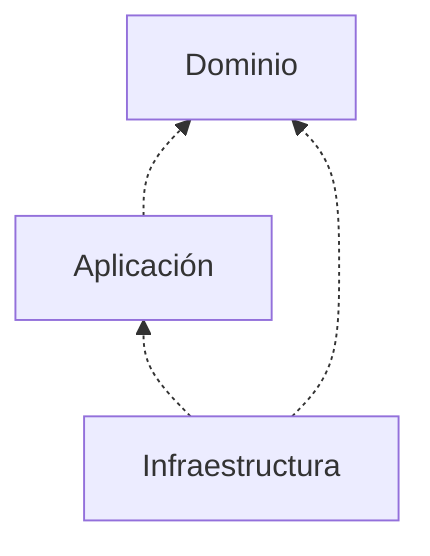

## Diseño

La arquitectura se describe en [Arquitectura y estructura](arquitectura.md).

### Nivel 1: capas



### Nivel 2: paquetes

```
es.etg.daw.dawes.sinessa
├── common/infraestructure/web/error
└── pelicula
    ├── domain
    │   ├── model
    │   └── repository
    ├── application
    │   ├── command
    │   ├── usecase
    │   └── service
    └── infraestructure
        ├── web
        │   ├── mvc/controller
        │   ├── mvc/dto
        │   ├── mapper
        │   └── config
        └── db/repository/mock
```

## Gestión de errores y excepciones

La aplicación gestiona los errores en dos puntos y deja el resto al comportamiento por defecto de Spring.

### Datos de entrada inválidos

Al crear una película, `@Valid` comprueba el `PeliculaRequest`. Si algún campo no cumple las reglas, el controlador captura la excepción `MethodArgumentNotValidException` y responde con un error 400 y una página que lista cada campo con su mensaje. Los mensajes están centralizados en `messages.properties`, y el texto se escapa antes de mostrarse para evitar inyección de HTML.

### Errores internos

`GlobalExceptionHandler` (`common/infraestructure/web/error`) captura `NullPointerException` y responde con un error 500 y una página con la fecha, el código y el mensaje (`CustomResponse`).

### Película que no existe

Editar o eliminar un id inexistente hace que `FindPeliculaByIdUseCase` lance `NoSuchElementException`. Como no hay un manejador específico, Spring devuelve su respuesta de error por defecto (500) en lugar de un 404. Es una mejora pendiente.

### Edición

El `PUT` no valida los datos de entrada, y solo modifica `imagen`, `sinopsis` y `duracion`.

## Plan de pruebas

Las pruebas son manuales, con `curl` o con el formulario `/formularioPelicula.html`, y una automática con `./mvnw test`. Se parte de los datos iniciales: tres películas con ids 1, 2 y 3.

| Nº | Operación | Caso | Resultado esperado |
| --- | --- | --- | --- |
| 1 | Listar | `GET /peliculas` | 200 y JSON con las 3 películas iniciales |
| 2 | Crear | Datos válidos | 200 y página con la película creada (id 4) |
| 3 | Crear | Título vacío | 400 con el error del campo `titulo` |
| 4 | Crear | Duración 0 | 400 con el error del campo `duracion` |
| 5 | Crear | Imagen con URL inválida | 400 con el error del campo `imagen` |
| 6 | Crear | Fecha con formato `1979-05-25` | Error de validación en `fechaEstreno` |
| 7 | Editar | `PUT /peliculas/1` con imagen, sinopsis y duración | 200 y JSON con esos tres campos cambiados |
| 8 | Editar | `PUT /peliculas/99` (no existe) | Error 500 por defecto |
| 9 | Eliminar | `DELETE /peliculas/1` | 204 y la película ya no aparece en el listado |
| 10 | Eliminar | `DELETE /peliculas/99` (no existe) | Error 500 por defecto |
| 11 | Arranque | `./mvnw test` | Pasa `contextLoads` (el contexto de Spring arranca) |

