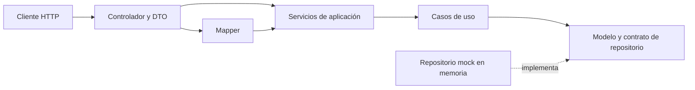

# Diseño

## Arquitectura

Sinessa sigue una arquitectura por capas inspirada en Clean Architecture y organiza el código por funcionalidad (vertical slice de películas). Las dependencias apuntan hacia el dominio: la infraestructura implementa contratos definidos en el dominio, mientras que las reglas de aplicación no dependen de Spring MVC ni del repositorio concreto.



La configuración `PeliculaConfig` registra los casos de uso y servicios como beans de Spring. `PeliculaRepositoryMockImpl` implementa el contrato `PeliculaRepository`, por lo que la aplicación puede sustituir esa implementación sin cambiar los casos de uso.

## Niveles y paquetes

```text
es.etg.daw.dawes.sinessa
├── SinessaApplication.java
├── common/infraestructure/web/error
└── pelicula
    ├── domain
    │   ├── model/Pelicula.java
    │   └── repository
    ├── application
    │   ├── command
    │   ├── service
    │   └── usecase
    └── infraestructure
        ├── db/repository/mock
        └── web
            ├── config
            ├── mapper
            └── mvc
                ├── controller
                └── dto
```

- **Dominio:** `Pelicula`, `CRUDRepository` y `PeliculaRepository` describen el modelo y las operaciones.
- **Aplicación:** comandos, servicios y casos de uso para crear, listar, buscar por id, editar y eliminar.
- **Infraestructura:** controlador HTTP, DTO, mapper, configuración Spring y repositorio en memoria.
- **Errores comunes:** `GlobalExceptionHandler` centraliza el manejo de `NullPointerException`.

## Flujo de petición

Para una consulta, el controlador invoca el servicio, el caso de uso consulta el contrato de repositorio y el mapper convierte el resultado a DTO. Para el alta, los parámetros se vinculan a `PeliculaRequest`, Jakarta Validation comprueba las restricciones, el mapper crea un comando y el caso de uso añade la entidad al repositorio.

## Errores y excepciones

- **Validación del alta:** los errores de `@Valid` producen HTTP 400 y una página HTML con los campos y mensajes. Se escapan los textos antes de incluirlos en HTML.
- **Error interno nulo:** `GlobalExceptionHandler` convierte `NullPointerException` en HTTP 500 y genera una respuesta HTML con fecha, estado y mensaje.
- **Identificador inexistente:** la búsqueda lanza `NoSuchElementException`; no existe un manejador específico y actualmente Spring resuelve la respuesta. Se recomienda añadir un error de dominio y traducirlo a HTTP 404.
- **Edición:** el endpoint no aplica `@Valid`; actualmente solo se actualizan imagen, sinopsis y duración. Conviene validar la entrada y decidir/documentar explícitamente si los campos restantes son inmutables.

## Plan de pruebas

No se automatiza aquí la ejecución de pruebas; los siguientes escenarios sirven para una comprobación manual con `curl` o el formulario. Antes de cada caso, iniciar la aplicación y recordar que los datos vuelven a su estado inicial al reiniciarla.

| Nº | Acción | Comprobación esperada |
| --- | --- | --- |
| 1 | `GET /peliculas` | HTTP 200 y listado JSON con los registros iniciales. |
| 2 | `POST /peliculas` con datos válidos | Se crea el registro y se muestra una página HTML de confirmación. |
| 3 | Alta con título vacío | HTTP 400 y mensaje de validación de `titulo`. |
| 4 | Alta con duración cero o ausente | HTTP 400 y mensaje de validación de `duracion`. |
| 5 | Alta con URL de imagen inválida | HTTP 400 y mensaje de validación de `imagen`. |
| 6 | Alta con fecha mal formada | Error de vinculación/validación de la fecha. El formato esperado es `dd/MM/yyyy`. |
| 7 | `PUT /peliculas/1` | La respuesta JSON refleja imagen, sinopsis y duración actualizadas. |
| 8 | `DELETE /peliculas/1` | HTTP 204; el id deja de aparecer en el listado. |
| 9 | Editar o eliminar id inexistente | La petición falla; no se garantiza HTTP 404 en esta versión. |

## Capturas y evidencia de ejecución

Evidencias [img](img)